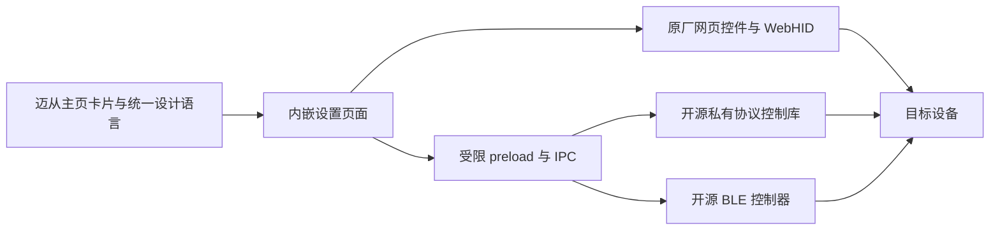

# MCHOUSE_for_all

> 本分支是 G309／有线 BlackShark V2 的实机交接预发布；请见文末下载表与 handoff/README.md，稳定版仍为 v0.1.1。

让不同品牌的设备使用同一套 MCHOSE HUB 卡片和设置界面。TANK68 HE、Razer Viper Mini SE 和 CUKTECH 10 Ultra 是三种接入路线的示范：网页驱动、厂商私有协议、蓝牙。共用设计语言、控件、前端接口和注入源码已整理为 [One4All Kit 开发库](library)。

| 按设备独立下载 | 接入路线 | 解压后运行 |
| --- | --- | --- |
| [TANK68 HE 安装包](https://github.com/YuYiChyan/MCHOUSE_for_all/releases/download/v0.1.1/tank68-v0.1.1-win64.zip) · [源码](tank68) | USB 磁轴键盘，保留原厂网页控件 | tank68/Install.cmd |
| [Razer Viper Mini SE 安装包](https://github.com/YuYiChyan/MCHOUSE_for_all/releases/download/v0.1.1/razer-mini-se-v0.1.1-win64.zip) · [源码](razer-mini-se) | 厂商私有 USB/HID 协议，复用 openrazer-win | razer-mini-se/Install.cmd |
| [CUKTECH 10 Ultra 安装包](https://github.com/YuYiChyan/MCHOUSE_for_all/releases/download/v0.1.1/cuktech-10-ultra-v0.1.1-win64.zip) · [源码](cuktech-10-ultra) | BLE 蓝牙，复用开源 CUKTECH 控制器 | cuktech-10-ultra/Install.cmd |
| [One4All Kit 开发库](https://github.com/YuYiChyan/MCHOUSE_for_all/releases/download/v0.1.1/one4all-kit-v0.1.1.zip) · [说明](library) | 共用样式、控件、接口、网页桥接与打包注入源码 | 供开发者复用，无需安装到设备 |

**只下载需要的安装包即可，无需下载整个仓库，也无需先安装开发库。** 每个设备包包含运行所需的共用代码；鼠标和充电器另带 Python 与依赖。完整解压后双击对应目录的 Install.cmd。键盘首次安装自动获取原厂网页；各卡片首次安装会准备本机图标及字体。更多版本和校验文件见 [发布页](https://github.com/YuYiChyan/MCHOUSE_for_all/releases)。

每个项目有 Install、Repair、Uninstall 三个入口。更新恢复任务在应用关闭后修复被覆盖的加载入口；绑定、依赖和项目文件存放在官方更新目录之外。无需修改硬件固件。

**状态：0.1.1，非官方扩展。** 目前适配资源解包存放的 Windows x64 MCHOSE HUB，厂商更改 DOM、页面地址或打包结构后可能需要调整。验证范围见 [VALIDATION.md](VALIDATION.md)。本仓库不包含账号凭据、原厂主程序或原厂驱动压缩 JS/CSS。

项目原创代码默认 MIT；鼠标项目及其 openrazer-win 依赖按该子目录 GPL-2.0-or-later 许可。第三方包、商标、商品图及厂商资源遵循各自权利和许可证，详见 [THIRD_PARTY.md](THIRD_PARTY.md)。

## 开发思路：把设备接入同一套界面

### 迈从驱动的本质

本次检查的 MCHOSE HUB 是基于 Electron 的桌面应用，可以理解为 **Chromium 浏览器核心 + 网页界面 + Node.js 主进程 + 厂商设备通信及系统依赖库**。本机安装目录可见 `resources/app/out/main`、`out/preload`、网页资源以及 `koffi`、`usb`、`win-audio` 等依赖；当前主入口还使用了字节码加载器。这个判断针对已检查版本，不代表所有历史或未来版本的实现都相同。

浏览器负责绘制界面，主进程和本地库负责访问设备。网页通过受限的 preload / IPC 接口调用本地能力，因此可以保持统一的外观，同时接入不同品牌的底层协议。Electron 的 [进程模型](https://www.electronjs.org/docs/latest/tutorial/process-model) 和 [WebContentsView](https://www.electronjs.org/docs/latest/api/web-contents-view) 说明了这层分工。



### 三个示范分别解决什么问题

| 路线 | 示范 | 前端怎么做 | 设备通信由谁处理 |
| --- | --- | --- | --- |
| 有原厂网页驱动的 USB 磁轴键盘 | TANK68 HE | 映射原厂菜单，左侧使用统一导航，右侧嵌入同源原厂页面，保留键盘和原有设置控件 | 原厂网页及其 WebHID 逻辑 |
| 厂商私有协议设备 | Razer Viper Mini SE | 使用共用控件重建设置页，将电量、DPI、回报率映射为前端字段与操作 | 已有开源通信库 openrazer-win；私有协议不等于必须重写内核驱动 |
| BLE 蓝牙设备 | CUKTECH 10 Ultra | 使用同一设计语言呈现端口、功率曲线和连接入口 | 开源 CUKTECH BLE 控制器及 Bleak；认证信息留在本机服务 |

后两条路线复用的是开源**通信库/控制器**，其原有界面不一定能直接当控件使用。应保留成熟的协议实现，只增加薄适配层，把结果交给统一前端。前一条路线尽量复用原厂网页里的完整功能区域，减少重新实现复杂键盘设置产生的回归。

### 面向哪些设备扩展

项目希望覆盖所有具有可用网页驱动的其他品牌外设、其他网页驱动设备，以及具有可用开源控制器的 USB、私有协议和 BLE 设备。这是**可扩展的候选范围**；当前实测示范仍是上面的三个型号，并非所有设备已经自动兼容。

接入前先确认实际使用的是 WebHID、WebUSB、Web Serial、Web Bluetooth，还是本地辅助程序。网页能在浏览器打开不等于内嵌后就有硬件权限。还要检查 Chromium 版本、系统权限、VID/PID、独占访问、认证流程，以及网页是否允许嵌入。不能嵌入 iframe 的页面可评估独立 WebContentsView 或官方支持的集成方式；应遵守站点授权和资源许可。

当前宿主的自动硬件授权只适配示范键盘的 VID/PID。其他设备需要单独实现与验证相应权限处理，不能直接扩大成允许访问全部设备。

### 怎样开发同款控件

1. 从 [开发库](library) 取用布局、亮暗样式与 `One4AllUI`。保持 60px 顶栏、320px 侧栏、40px 菜单、统一卡片/分段按钮和主题色；窄窗口使用对应响应式规则。先打开 `library/examples/widgets.html` 看可运行的控件示例。
2. 首页克隆迈从当前原生卡片，继承 scoped 样式；同步 `is-list`、`is-dark` 和玻璃效果状态。平铺和列表分别检查，不把图片高度写死到全部视图。
3. 网页驱动路线：保持原厂组件的状态、事件和通信逻辑，优先做菜单映射、重复导航隐藏、视口调整和原厂主题映射。跨源页面不能直接操作 DOM；同源本地资源也需要遵守许可。
4. 开源控制器路线：把连接、只读状态、命令写入与回读、重连和退出清理放在适配层；前端只显示状态和触发白名单操作。可参考 `library/bridge/adapter.cjs` 和接口说明。
5. 跟随主程序主题，在设备回读确认后更新按钮状态；断线或缺失数据显示“—”。蓝牙协议与通知刷新率依设备决定，不能用重复显示旧数值冒充实时刷新。

开发库已有的复用接口见 [IPC 对照表](library/contracts/ipc.json)；新增设备的注册位置、数据模型和注意事项见 [开发指南](docs/DEVELOPMENT.md)。目前示范宿主使用显式设备白名单，新增品牌仍需注册卡片和通信接口；开发库不是未经适配就能加载任意外设的通用驱动。

### 独立打包与注入

每个设备单独维护 `manifest.json`、页面、控制器和所需依赖。发布时将共用库复制进该设备包，附带 Install / Repair / Uninstall 脚本，生成一个可单独解压使用的 ZIP。用户不必安装开发环境，也不必下载其他品牌的依赖。

安装器定位当前 MCHOSE 运行目录，将设备代码与数据部署到 `%USERPROFILE%/One4All`，备份原始入口，再用小型加载器接入原厂主进程。官方更新覆盖入口后，后台检查在应用关闭且文件稳定时重新注入；卸载最后一个卡片时恢复原厂入口，保留绑定数据。共享宿主源码统一在 `library` 维护，通过同步脚本生成各设备包，避免分别修改各份共用代码。

```powershell
.\scripts\Sync-Library.ps1
.\tests\Verify-Packages.ps1
.\scripts\Build-Releases.ps1 -Version 0.1.1
```

完整步骤、依赖离线打包和新增设备发布约定见 [打包与注入指南](docs/PACKAGING.md)。

## 欢迎添加其他品牌的设备安装包

非常欢迎大家为这个库贡献其他品牌、其他设备类型的独立安装包，也欢迎完善共用控件和接入接口。可以先提 Issue 交流设备型号、已有网页驱动或开源控制器，再通过 PR 添加示范、测试记录和单独下载入口。具体步骤见 [CONTRIBUTING.md](CONTRIBUTING.md)。
# 新设备交接分支：肥鱼（DSH）接收

本分支增加 **Logitech G309** 与 **有线 BlackShark V2 原配 USB 声卡**的前端、协议／系统接口与独立注入包。阶段为 `v0.2.0-handoff.1` 预发布；尚未完成这两款设备的实机调试与验收。原正式发行版仍见 v0.1.1。

| 项目 | 独立下载 | 接收文档 |
| --- | --- | --- |
| Logitech G309 | [Win64 交接包](https://github.com/YuYiChyan/MCHOUSE_for_all/releases/download/v0.2.0-handoff.1/logitech-g309-v0.2.0-handoff.1-win64.zip) | [实现、注入与清单](logitech-g309/HANDOFF.md) |
| BlackShark V2 USB 声卡 | [Win64 交接包](https://github.com/YuYiChyan/MCHOUSE_for_all/releases/download/v0.2.0-handoff.1/blackshark-v2-v0.2.0-handoff.1-win64.zip) | [实现、注入与清单](blackshark-v2/HANDOFF.md) |
| 可选 Equalizer APO | [固定源码与许可](https://github.com/YuYiChyan/MCHOUSE_for_all/releases/download/v0.2.0-handoff.1/blackshark-v2-optional-eq-v0.2.0-handoff.1.zip) | [选择、启用和撤销](blackshark-v2/OPTIONAL-EQ.md) |
| 共用开发库 | [Kit](https://github.com/YuYiChyan/MCHOUSE_for_all/releases/download/v0.2.0-handoff.1/one4all-kit-v0.2.0-handoff.1.zip) | [肥鱼交接入口](handoff/README.md) |

两款设备包已经包含各自 Python 运行时、必要依赖、前端、注入／修复／卸载脚本、产品轮廓素材与结构化视觉规格。BlackShark 基础功能不依赖雷云；THX 原生声场控制尚无已验证接口。可选 EQ 的页面和配置适配已实现，默认只导出，安装音频引擎由接收方选择。可选源码包不含安装器；官方镜像本次下载返回 403，文档给出了官方来源。

---
