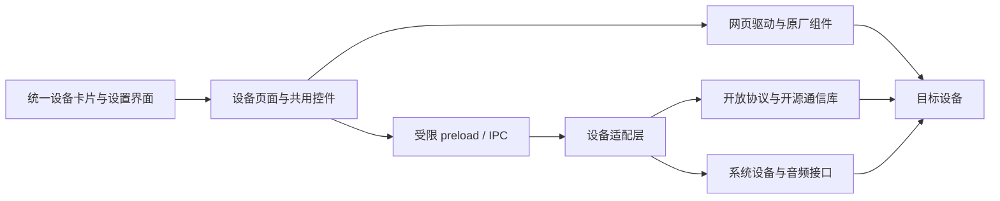

# MCHOUSE_for_all

**让 MCHOSE HUB 成为跨品牌、跨协议的统一设备控制平台。**

我们的目标是覆盖市面上大部分外设，并将设备控制的范围延伸到外设之外：键盘、鼠标、耳机、充电器，以及任何具备可用网页驱动、开放接口、开放协议或开源通信库的设备，都可以成为这个平台的一部分。

理论上，只要设备存在能够合法使用的控制入口，就可以开发适配层，把它的状态、设置与交互接入 MCHOSE HUB。项目希望把分散在不同品牌客户端、网页驱动和开源工具中的能力，汇集到统一的卡片、导航、主题与设置体验中。每完成一项适配，就提供一个可以单独下载安装的设备包，并持续扩展支持列表。

[下载独立设备包](https://github.com/YuYiChyan/MCHOUSE_for_all/releases/latest) · [开发库](library) · [开发指南](docs/DEVELOPMENT.md) · [参与贡献](CONTRIBUTING.md)

## 当前支持列表

**更新时间：2026-10-22 · 设备适配包：0.2.0 · 通用控件：0.3.0-preview.4**

下表列出已经完成适配、提供独立安装包的设备。项目的扩展目标覆盖所有满足接入条件的设备；具体型号的功能范围与验证记录随适配持续更新。

| 设备 | 接入方式 | 独立安装包 | 实现与说明 |
| --- | --- | --- | --- |
| TANK68 HE | USB / 原厂网页驱动 | [下载](https://github.com/YuYiChyan/MCHOUSE_for_all/releases/download/v0.2.0/tank68-v0.2.0-win64.zip) | [tank68](tank68) |
| Razer Viper Mini SE | USB / 2.4G 接收器 / 开源私有协议库 | [下载](https://github.com/YuYiChyan/MCHOUSE_for_all/releases/download/v0.2.0/razer-mini-se-v0.2.0-win64.zip) | [razer-mini-se](razer-mini-se) |
| CUKTECH 10 Ultra | BLE / 开源蓝牙控制器 | [下载](https://github.com/YuYiChyan/MCHOUSE_for_all/releases/download/v0.2.0/cuktech-10-ultra-v0.2.0-win64.zip) | [cuktech-10-ultra](cuktech-10-ultra) |
| Logitech G309 | HID++ / LIGHTSPEED；蓝牙能力按设备与接口确认 | [下载](https://github.com/YuYiChyan/MCHOUSE_for_all/releases/download/v0.2.0/logitech-g309-v0.2.0-win64.zip) | [logitech-g309](logitech-g309) |
| BlackShark V2 有线 USB 声卡 | Windows Core Audio / 可选 Equalizer APO | [下载](https://github.com/YuYiChyan/MCHOUSE_for_all/releases/download/v0.2.0/blackshark-v2-v0.2.0-win64.zip) | [blackshark-v2](blackshark-v2) |
| 通用 HID 键鼠控件 | Windows 标准 HID / 内置 VIA | [下载](https://github.com/YuYiChyan/MCHOUSE_for_all/releases/download/v0.3.0-preview.4/One4All-Generic-HID-0.3.0-preview.4.zip) | [generic-hid](generic-hid) |

通用控件提供标准按键状态检测、键盘/鼠标按下高亮、HID 设备与接口信息显示、名称和商品图设置，以及内置 VIA 的按键测试、连接和厂商 JSON 导入。不要求型号已被 VIA 官方收录；实际连接与硬件改键仍需设备固件支持 VIA 协议。它不代表所有标准 HID 设备都支持灯效或硬件改键，详细范围见 [通用控件说明](docs/GENERIC-HID-KEYBOARD.md)。

**只下载需要的设备包，完整解压后运行设备目录内的 `Install.cmd`。** 每包自带共用代码及所需运行依赖，无需下载整个仓库或另装开发环境。各包提供安装、修复与卸载入口，支持多张卡片共存。

开发者可单独下载 [One4All Kit](https://github.com/YuYiChyan/MCHOUSE_for_all/releases/download/v0.2.0/one4all-kit-v0.2.0.zip)。可选 [EQ 套件](https://github.com/YuYiChyan/MCHOUSE_for_all/releases/download/v0.2.0/blackshark-v2-optional-eq-v0.2.0.zip)包含 Equalizer APO 官方安装器、对应源码与许可，耳机独立包也已携带；按需运行 `Install-EQ.cmd` 后，在 App 内调节十段 EQ。基础声卡控制无需雷云或 EQ 引擎。

发布附件与 SHA256 校验文件见 [发布页](https://github.com/YuYiChyan/MCHOUSE_for_all/releases)。已有适配的功能与验收范围见各设备说明、[验证记录](VALIDATION.md)及 [0.2.0 验收记录](docs/ACCEPTANCE-0.2.0.md)。新增设备时同步更新本表日期、版本与下载入口。

## 开发思路

### 以浏览器界面为宿主，以设备适配层连接硬件

已检查的 MCHOSE HUB 基于 Electron：Chromium 浏览器核心负责绘制网页界面，Node.js 主进程与本地依赖库负责设备通信和系统能力。安装资源中可见主进程、preload、网页资源，以及 `koffi`、`usb`、`win-audio` 等依赖。

这套结构提供了清晰的扩展位置：保留宿主的主界面与运行环境，通过设备卡片打开设置页面，再由受限的 preload / IPC 接口连接本地适配器。页面统一呈现状态和操作；适配器负责身份识别、协议交互、参数验证、设备回读、重连与退出清理。



### 根据设备的控制入口选择接入方式

| 设备已有的控制能力 | 接入方法 | 前端实现 |
| --- | --- | --- |
| 可用的网页驱动 | 复用网页中的设备组件与通信逻辑，按所用 WebHID、WebUSB、Web Serial 等能力处理权限 | 将原厂功能区域嵌入右侧内容框，映射左侧导航、视口和主题 |
| 开源 USB / HID 或厂商私有协议控制库 | 保留成熟协议实现，增加薄适配层，暴露经过校验的设备操作 | 使用公共控件呈现状态、参数和设备能力支持的选项 |
| BLE / 其他可编程通信接口 | 复用开源控制器，处理设备发现、认证、通知订阅、重连与凭据保存 | 映射连接入口、实时状态、图表和可写设置 |
| 操作系统提供标准设备接口 | 通过系统接口关联目标设备，完成控制与回读 | 使用同一套设置框与交互反馈 |
| 独立开源处理引擎 | 通过其配置、命令行或正式接口接入，打包必要依赖与启用入口 | 在项目页面提供参数编辑、保存、旁路和撤销操作 |

设备类型可以超出传统外设。具有合适控制入口的音频设备、电源设备、传感器、桌面配件及其他可编程硬件，都可以沿这些路线开发集成。接入前需要确认硬件接口、系统权限、组件授权、设备身份及可回读能力；当前版本的安装器和权限规则仍需为新增设备逐项登记。

### 复用网页与组件，保留成熟的设备控制能力

有网页驱动的设备优先复用原有功能区域，保留组件状态、事件、校准及通信逻辑。统一界面负责导航映射、重复区域隐藏、主题同步和内容框布局，减少重新实现复杂设置造成的功能回归。

网页嵌入需确认同源关系、站点许可和硬件访问方式。允许嵌入的页面可使用 iframe；需要独立页面环境时，可评估 Electron 的 WebContentsView。新的品牌和型号必须单独登记设备权限，避免扩大为允许访问全部硬件。

有开源控制器的设备复用其协议与传输实现，由适配层把底层数据整理成稳定的状态模型和命令接口。原库的界面不一定适合直接嵌入，前端可以用共用控件重新呈现。写入后读取设备确认结果，断线或读取失败时清除过期状态，按设备上报的能力开放选项。

### 用同一套设计语言组织设备体验

[One4All Kit](library)提供共用样式、控件、主题与前端桥接接口。设备页面遵循宿主的顶栏、左侧设备区与菜单、右侧设置框布局；沿用统一的间距、字号、卡片、分段按钮、滑块和交互反馈。

首页复用宿主当前的原生卡片模板，继承 scoped 样式及 `is-list`、`is-dark`、毛玻璃等状态，分别适配列表与网格。设备贴图、配色选择和设置页同步，并保存用户选择。页面跟随宿主亮暗主题，窗口缩小时保持导航和主要操作可用。

共用控件入口见 [组件示例](library/examples/widgets.html)，接口映射见 [IPC 对照表](library/contracts/ipc.json)，设备注册位置与数据模型见 [开发指南](docs/DEVELOPMENT.md)。公共代码集中维护在 `library`，再同步生成各设备包，保证独立安装时也能复用同一套实现。

### 按设备独立打包与注入

每款设备独立维护 `manifest.json`、页面、适配器、所需运行时和依赖。发布时将必要的公共库复制进设备包，附带 `Install`、`Repair`、`Uninstall` 脚本，生成可单独下载使用的 ZIP。开源依赖随包保留版本、来源、哈希及许可。

安装器定位当前 MCHOSE HUB 目录，将扩展与数据部署到官方更新目录之外，备份原始入口，再通过小型加载器接入主进程。更新恢复任务在应用关闭、入口文件稳定后修复加载入口；卸载单个设备只取消对应卡片，最后一个卸载后恢复原厂入口。绑定信息与账号凭据留在本机，禁止进入源码和公开发布包。

```powershell
.\scripts\Sync-Library.ps1
.\tests\Verify-Packages.ps1
.\scripts\Build-Handoff.ps1 -Version 0.2.0
.\tests\Release-Packages.ps1 -Version 0.2.0
```

当前安装器支持资源解包存放的 Windows x64 MCHOSE HUB。宿主打包形式、页面结构或协议变化时，需要更新相应适配。完整的离线依赖、注入、验证与发布约定见 [打包指南](docs/PACKAGING.md)。

## 一起扩展设备支持范围

欢迎为更多品牌、更多设备形态贡献独立安装包，也欢迎补充开源控制器、网页驱动入口、协议文档和实机测试结果。

可以先提交 Issue，说明设备型号、连接方式、现有网页驱动或开源接口，再通过 PR 加入设备页面、适配器、依赖与独立安装脚本。设备贡献沿用公共设计语言，补齐功能回读、共存安装、修复、卸载和主题布局验证，随后更新支持列表与单独下载入口。具体要求见 [CONTRIBUTING.md](CONTRIBUTING.md)。

本项目是非官方扩展，与设备品牌无隶属关系。原创公共代码默认 MIT；各设备及第三方代码按对应目录许可使用。原厂程序、网页组件、商标与商品图遵循各自权利和授权，详见 [THIRD_PARTY.md](THIRD_PARTY.md)。
