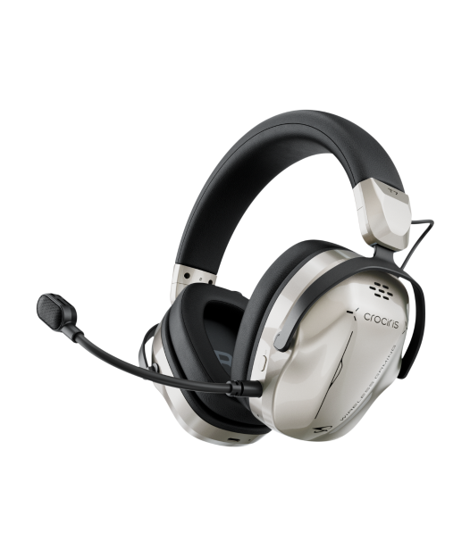
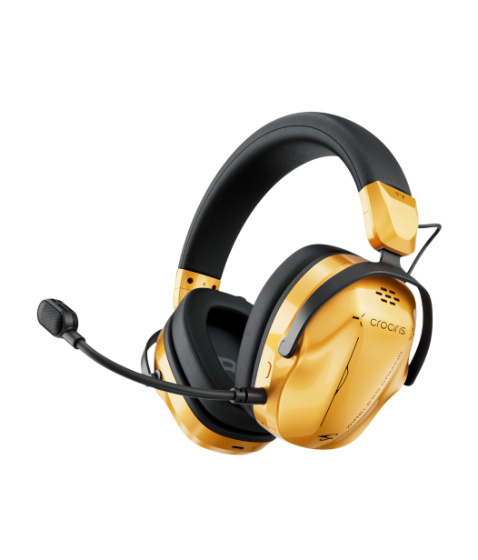
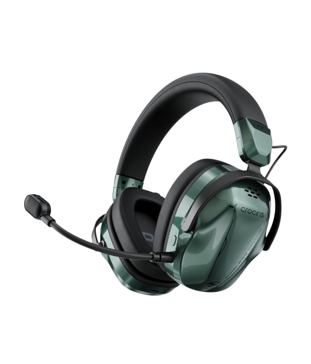
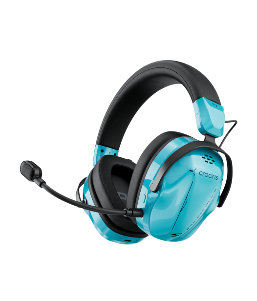

# CROCIRIS T7

版本：0.4.0-preview.2 · **待验证**

完整解压后运行 `Install.cmd`。本包包含此产品的卡片、原厂商品图及配色、设备页面、注入 / 修复 / 卸载程序、Python 与音频依赖，以及未修改的官方 X HUB 0.3.0.6 原版安装器。首次安装官方音频组件后可能需要重启；安装器不会主动重启 Windows。

运行 `Uninstall.cmd` 只取消本型号的卡片，保留其他已安装卡片。

界面包含声音输出、均衡器、空间音效、麦克风、设备信息五个分页；“打开官方 APP”位于设备信息。设备未连接时读数显示为空，控制项按实际能力开放。

## 商品图与配色

## 反馈

[提交型号验证反馈](https://github.com/YuYiChyan/MCHOUSE_for_all/issues/new?template=device-validation.yml)。具体验证状态见 [VALIDATION.md](VALIDATION.md)。
